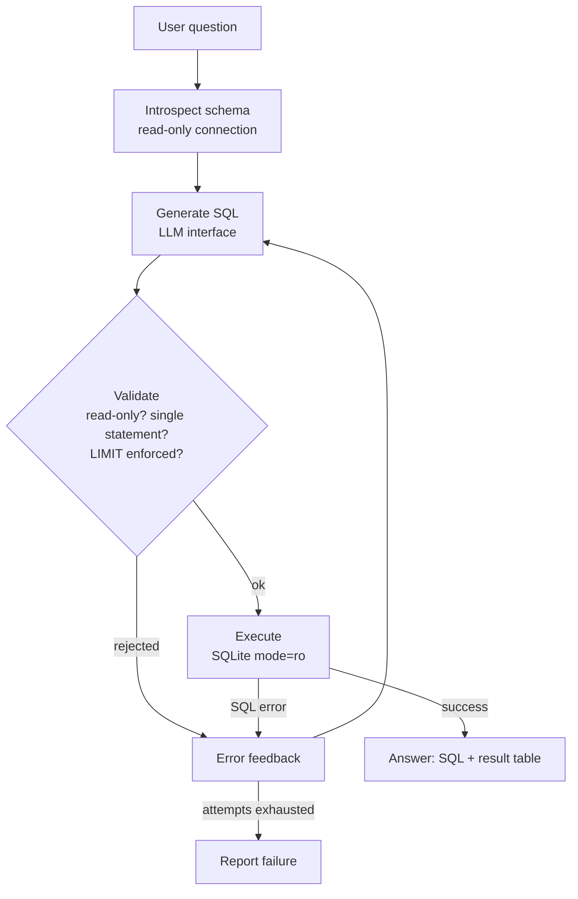

# Text-to-SQL Agent

Ask questions about a database in plain English and get back working SQL —
plus the answer. The agent introspects the schema, generates a query,
validates it as read-only, executes it, and if anything fails it feeds the
error back to the generator and tries again.

## Problem statement

Business users know what they want to know — *"how many active subscribers
per plan?"*, *"what is the revenue per plan?"* — but not the SQL, table
names, or join paths needed to get it. Hand-writing those queries is slow,
and handing a language model direct database access is risky: a generated
statement could write, delete, or scan without limit.

This project is a small, safe, fully offline text-to-SQL agent over a
bundled sample database:

* the schema is discovered at runtime, not hard-coded into prompts,
* every generated statement must pass a read-only validator (single
  `SELECT`, no write/DDL keywords, enforced `LIMIT`) and runs on a
  read-only SQLite connection,
* failed queries are not the end of the run — the error is fed back and
  the generator retries, up to a configurable maximum,
* correctness is measured, not asserted: an eval harness scores the agent
  by executing both its queries and hand-written reference queries and
  comparing the result sets.

## Architecture



The pipeline is implemented as a graph of three nodes (`introspect`,
`generate`, `execute`) with a conditional edge that loops `execute ->
generate` while attempts remain. The same node functions also run under a
built-in fallback driver (see Design decisions).

## Quickstart

```bash
cd text-to-sql-agent
python3 -m venv .venv && source .venv/bin/activate
pip install -e ".[dev]"

# 1. generate the sample database (deterministic, seed 42)
python -m text_to_sql_agent.seed

# 2. ask a question
python -m text_to_sql_agent "how many active subscribers per plan?"

# 3. run the tests and the eval
python -m pytest -q
python -m text_to_sql_agent.evaluate
```

No API keys and no network are needed for any of the above: the default
generator is deterministic and offline. A real provider can be plugged in
through environment variables only (see Design decisions).

## Example output (captured from a real run)

```text
$ python -m text_to_sql_agent "how many active subscribers per plan?"
Question: how many active subscribers per plan?
SQL: SELECT p.plan_name, COUNT(*) AS active_subscribers FROM subscriptions s JOIN plans p ON p.plan_id = s.plan_id WHERE s.status = 'active' GROUP BY p.plan_name ORDER BY p.plan_name LIMIT 100
Attempts: 1  Backend: langgraph
plan_name | active_subscribers
----------+-------------------
Basic     | 67
Family    | 53
Premium   | 108
Standard  | 110
Unlimited | 59
(5 row(s))
```

```text
$ python -m text_to_sql_agent "Who are the top 5 customers by total paid invoice amount?"
Question: Who are the top 5 customers by total paid invoice amount?
SQL: SELECT c.full_name, ROUND(SUM(i.amount), 2) AS total_paid FROM invoices i JOIN customers c ON c.customer_id = i.customer_id WHERE i.status = 'paid' GROUP BY c.customer_id, c.full_name ORDER BY total_paid DESC, c.full_name ASC LIMIT 5
Attempts: 1  Backend: langgraph
full_name   | total_paid
------------+-----------
Chen Garcia | 750.8
Fatima Khan | 713.2
Noah Novak  | 707.85
Anita Ali   | 666.65
Ravi Dubois | 647.8
(5 row(s))
```

Self-correction, exercised by the test suite with a generator whose first
query references a non-existent column (`SELECT customer_name FROM
customers`):

```text
success: True
attempts: 2
final SQL: SELECT COUNT(*) AS customer_count FROM customers LIMIT 100
rows: [(500,)]
```

## Eval (captured from a real run)

The eval set is 20 natural-language questions in `eval/questions.json`,
each with a hand-written reference query. Scoring is **execution
accuracy**: the agent's result set must equal the reference result set on
the same database.

```text
$ python -m text_to_sql_agent.evaluate
[PASS] Q 1 (1 attempt(s)) How many customers are there?
       SQL: SELECT COUNT(*) AS customer_count FROM customers LIMIT 100
[PASS] Q 2 (1 attempt(s)) How many active subscribers per plan?
       SQL: SELECT p.plan_name, COUNT(*) AS active_subscribers FROM subscriptions s JOIN plans p ON p.plan_id = s.plan_id WHERE s.status = 'active' GROUP BY p.plan_name ORDER BY p.plan_name LIMIT 100
[PASS] Q 3 (1 attempt(s)) What is the total revenue from paid invoices?
       SQL: SELECT ROUND(SUM(amount), 2) AS total_revenue FROM invoices WHERE status = 'paid' LIMIT 100
[PASS] Q 4 (1 attempt(s)) Which plan has the most active subscribers?
       SQL: SELECT p.plan_name, COUNT(*) AS active_subscribers FROM subscriptions s JOIN plans p ON p.plan_id = s.plan_id WHERE s.status = 'active' GROUP BY p.plan_name ORDER BY active_subscribers DESC, p.plan_name ASC LIMIT 1
[PASS] Q 5 (1 attempt(s)) How many customers are in each country?
       SQL: SELECT country, COUNT(*) AS customer_count FROM customers GROUP BY country ORDER BY country LIMIT 100
[PASS] Q 6 (1 attempt(s)) What is the average monthly price of all plans?
       SQL: SELECT ROUND(AVG(monthly_price), 2) AS avg_monthly_price FROM plans LIMIT 100
[PASS] Q 7 (1 attempt(s)) How many support tickets are open?
       SQL: SELECT COUNT(*) AS open_tickets FROM support_tickets WHERE status = 'open' LIMIT 100
[PASS] Q 8 (1 attempt(s)) How many support tickets are there by category?
       SQL: SELECT category, COUNT(*) AS ticket_count FROM support_tickets GROUP BY category ORDER BY category LIMIT 100
[PASS] Q 9 (1 attempt(s)) What is the average data usage per plan?
       SQL: SELECT p.plan_name, ROUND(AVG(u.data_used_gb), 2) AS avg_data_used_gb FROM usage_records u JOIN subscriptions s ON s.subscription_id = u.subscription_id JOIN plans p ON p.plan_id = s.plan_id GROUP BY p.plan_name ORDER BY p.plan_name LIMIT 100
[PASS] Q10 (1 attempt(s)) Who are the top 5 customers by total paid invoice amount?
       SQL: SELECT c.full_name, ROUND(SUM(i.amount), 2) AS total_paid FROM invoices i JOIN customers c ON c.customer_id = i.customer_id WHERE i.status = 'paid' GROUP BY c.customer_id, c.full_name ORDER BY total_paid DESC, c.full_name ASC LIMIT 5
[PASS] Q11 (1 attempt(s)) How many invoices are overdue?
       SQL: SELECT COUNT(*) AS overdue_invoices FROM invoices WHERE status = 'overdue' LIMIT 100
[PASS] Q12 (1 attempt(s)) What is the total amount of unpaid invoices?
       SQL: SELECT ROUND(SUM(amount), 2) AS total_unpaid FROM invoices WHERE status = 'unpaid' LIMIT 100
[PASS] Q13 (1 attempt(s)) How many subscriptions are cancelled?
       SQL: SELECT COUNT(*) AS cancelled_subscriptions FROM subscriptions WHERE status = 'cancelled' LIMIT 100
[PASS] Q14 (1 attempt(s)) What is the average invoice amount?
       SQL: SELECT ROUND(AVG(amount), 2) AS avg_invoice_amount FROM invoices LIMIT 100
[PASS] Q15 (1 attempt(s)) Which country has the most customers?
       SQL: SELECT country, COUNT(*) AS customer_count FROM customers GROUP BY country ORDER BY customer_count DESC, country ASC LIMIT 1
[PASS] Q16 (1 attempt(s)) How many support tickets are there by priority?
       SQL: SELECT priority, COUNT(*) AS ticket_count FROM support_tickets GROUP BY priority ORDER BY priority LIMIT 100
[PASS] Q17 (1 attempt(s)) What is the most expensive plan?
       SQL: SELECT plan_name, monthly_price FROM plans ORDER BY monthly_price DESC LIMIT 1
[PASS] Q18 (1 attempt(s)) What is the total data usage in GB?
       SQL: SELECT ROUND(SUM(data_used_gb), 2) AS total_data_used_gb FROM usage_records LIMIT 100
[PASS] Q19 (1 attempt(s)) How many subscriptions are there by status?
       SQL: SELECT status, COUNT(*) AS subscription_count FROM subscriptions GROUP BY status ORDER BY status LIMIT 100
[PASS] Q20 (1 attempt(s)) What is the revenue per plan from paid invoices?
       SQL: SELECT p.plan_name, ROUND(SUM(i.amount), 2) AS revenue FROM invoices i JOIN subscriptions s ON s.subscription_id = i.subscription_id JOIN plans p ON p.plan_id = s.plan_id WHERE i.status = 'paid' GROUP BY p.plan_name ORDER BY p.plan_name LIMIT 100

Execution accuracy: 20/20 = 100.0%
```

Tests (also real):

```text
$ python -m pytest -q
37 passed in 0.68s
```

## The sample database

`python -m text_to_sql_agent.seed` builds `data/sample.db` — a synthetic
telecom / e-commerce dataset, generated with a fixed seed (42) so it is
byte-for-byte reproducible in content:

```text
customers: 500 rows
invoices: 2893 rows
plans: 5 rows
subscriptions: 644 rows
support_tickets: 450 rows
usage_records: 1932 rows
Seeded data/sample.db (6424 rows total, seed=42)
```

Tables: `customers`, `plans`, `subscriptions`, `invoices`,
`usage_records`, `support_tickets`. All names, emails, and figures are
synthetic (`example.com` addresses); the data models ordinary commercial
activity only.

## Safety model

Defense in depth, in the order a query meets it:

1. **Validator** (`validator.py`) — rejects anything that is not a single
   `SELECT` / `WITH ... SELECT`; rejects write and DDL keywords
   (`INSERT`, `UPDATE`, `DELETE`, `DROP`, `ALTER`, `CREATE`, ...);
   rejects multi-statement batches; appends `LIMIT 100` when missing and
   clamps any limit above 1000. Keywords inside string literals do not
   trigger false rejections.
2. **Read-only connection** (`schema.py`) — the database is opened with
   SQLite URI `mode=ro` plus `PRAGMA query_only = ON`, so even a
   validator bug cannot mutate the file.
3. **Retry budget** — the self-correction loop stops at `--max-attempts`
   (default 3) and reports the last error instead of looping forever.

## Design decisions

* **Graph library with a real fallback.** The agent graph is built with
  LangGraph (verified installing and running cleanly, `langgraph 1.2.x`).
  Because the nodes are plain functions over a plain state dict, the same
  code also runs under a small hand-rolled state machine when LangGraph
  is absent — the CLI reports which backend served a run
  (`Backend: langgraph` vs `Backend: state-machine`). A repo that runs
  anywhere beats one that only runs with its full dependency set.
* **Deterministic offline generator by default.** `MockLLM` maps question
  patterns to SQL templates grounded in the introspected schema. That
  makes the CLI, the tests, and the eval reproducible with zero API keys —
  and makes the 100% eval score an honest statement about the patterns the
  eval covers, not a claim about arbitrary questions (see Limitations).
* **LLM behind an interface.** Generators implement one method:
  `generate(question, schema_text, error=None, previous_sql=None)`.
  The optional real-provider client (`EnvLLM`) is configured purely via
  `TEXT_TO_SQL_API_URL` / `TEXT_TO_SQL_API_KEY` / `TEXT_TO_SQL_MODEL`
  environment variables and speaks to a generic chat-completions style
  endpoint; nothing provider-specific is hard-coded.
* **Execution accuracy, not string matching.** Two different SQL strings
  can be the same query. The eval executes the agent's SQL and the
  reference SQL and compares row sets, so equivalent formulations pass.
* **Error feedback is data, not a log line.** On a retry the generator
  receives the exact validation/SQLite error and its previous query. The
  mock generator uses that channel for real work: a small
  identifier-correction table repairs common wrong column names
  (`customer_name` -> `full_name`, `plan_price` -> `monthly_price`, ...).
* **Deterministic seed data.** A fixed random seed means the eval numbers
  in this README are reproducible by anyone, on any machine.

## Limitations

* The offline generator covers the question patterns in the eval set and
  close paraphrases of them. Genuinely novel questions need a real
  provider configured through the environment variables — the agent loop,
  validator, and eval all work unchanged with one.
* SQLite dialect only. The validator's keyword approach is a guardrail
  for generated queries in this project, not a general SQL firewall.
* Single-database, single-turn questions: no conversational follow-ups
  ("and what about last month?") and no cross-database joins.
* Result comparison in the eval is order-insensitive and exact on values;
  floating-point-heavy questions are rounded in the queries themselves to
  keep that comparison stable.

## Project structure

```text
.
├── pyproject.toml
├── README.md
├── LICENSE
├── eval/
│   └── questions.json          # 20 questions + reference SQL
├── scripts/
│   ├── run_eval.py
│   └── seed_db.py
├── src/text_to_sql_agent/
│   ├── __init__.py
│   ├── __main__.py             # python -m text_to_sql_agent
│   ├── agent.py                # graph: introspect -> generate -> execute -> retry
│   ├── cli.py                  # argument parsing + table rendering
│   ├── evaluate.py             # execution-accuracy eval harness
│   ├── llm.py                  # generator interface, offline mock, env provider
│   ├── schema.py               # introspection + read-only execution
│   ├── seed.py                 # deterministic sample-database generator
│   └── validator.py            # read-only SQL validation + LIMIT enforcement
├── tests/
│   ├── conftest.py
│   ├── test_agent.py           # self-correction, attempt budget, write blocking
│   ├── test_eval_subset.py     # eval questions execute to expected results
│   ├── test_schema.py          # introspection correctness
│   └── test_validator.py       # writes / batches rejected, LIMIT rules
└── web/
    └── index.html              # static showcase of recorded runs
```

## License

MIT — see `LICENSE`.
